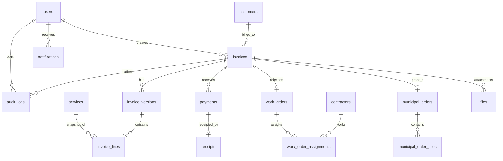

# Phase 0 Backend Blueprint

## 好幫手住宅裝修內部管理系統｜Direct Invoice Edition

**版本：** 0.1 Draft for sign-off  
**日期：** 2026-11-25  
**基準：** PRD v1.0（Direct Invoice Edition）及 production `e54d5b9`  
**狀態：** Phase 0 設計草案；未開始寫 backend  
**目標：** 先鎖定 architecture、角色權限、資料模型、API、編號、audit、migration 及 phase 範圍，避免直接將 localStorage prototype 搬上 server。

---

## 0. Executive decision

### 0.1 建議架構

```text
React / Vite (Vercel)
        │ HTTPS + JWT
        ▼
API Server (TypeScript, Vercel Functions)
        │ service-side validation + permission
        ├── PostgreSQL (Supabase)
        ├── Auth (Supabase Auth)
        ├── Private Object Storage (Supabase Storage)
        └── Audit / Sequences / Feature flags
```

- **Frontend：** 現有 React/Vite，保留 UI。
- **API：** `/api/v1`，TypeScript，server-side business rules。
- **Database：** PostgreSQL（建議 Supabase Postgres）。
- **Auth：** Supabase Auth，Admin 建立帳戶，不開放公開註冊。
- **File storage：** Private bucket + signed URL；付款證明、工程相片、文件。
- **ORM / validation：** Drizzle ORM + Zod。
- **Hosting：** Vercel frontend + API；Supabase DB/Auth/Storage。
- **Feature flags：** 中央 DB table，不再用 browser localStorage。

### 0.2 為什麼唔直接搬 localStorage

localStorage prototype 適合 demo，但不可以直接當 backend：

- 沒有真正 authentication／server-side permission
- 沒有 transaction、unique constraint、concurrency control
- 沒有中央 audit、backup、restore
- Browser 可以被改資料
- 檔案只在 IndexedDB
- 角色隱藏只在前端
- 編號可以由兩個 browser 同時產生同一號

**Domain rules 可以重用；persistence、auth、validation、permissions 必須重寫。**

### 0.3 Phase 0 要簽核的 8 個決策

| # | 決策 | 建議 default |
|---|---|---|
| D1 | Backend stack | Supabase Postgres/Auth/Storage + Vercel API + Drizzle |
| D2 | 現有資料是否需要 migration | 先確認；如只有 demo，clean start |
| D3 | Invoice 已收款／已出工程後可否修改 | **建議不可直接改**；用 change order／credit note（future） |
| D4 | 付款證明是否必需 | 非現金付款必需；現金可備註 |
| D5 | 8萬申請資料是否必需 | 可後補；未填顯示「待批核」 |
| D6 | 檔案保存期 | 付款／合約文件至少 7 年；相片按公司政策 |
| D7 | Admin feature flag | 中央 DB，Admin UI 控制 |
| D8 | Production hosting region | 香港／新加坡 nearest；避免跨區延遲 |

> 未簽核 D1–D8 前，不建議開始 Phase 1 schema migration。

---

## 1. Scope and assumptions

### 1.1 Phase 1–4 的 main flow

```text
Direct Invoice
→ Payment
→ 50% release
→ Work order
→ CS assignment
→ Engineering
→ Completion
→ Final payment / receipt
```

### 1.2 In scope for first backend

- Users / roles / server-side permissions
- Customers
- Service catalog / prices / snapshots
- Direct invoice and invoice versions
- Payment / proof / validation / receipt
- Work order / CS assignment / engineering completion
- 8萬 grant fields / municipal order
- Notifications
- Documents / PDF / Excel
- Audit log / central feature flags

### 1.3 Out of scope for first backend

- Sales quote creation/signing/Office submission
- Sales schedule/performance/commission
- Full procurement PO / goods receipt / supplier bill
- Government grant submission
- Bank API integration
- AI extraction/OCR

### 1.4 Assumptions

- Production currently has demo/local data; real migration status to confirm.
- Company staff use desktop primarily; mobile responsive is desired but not first blocker.
- One user has one primary role; extra grants possible.
- Existing old Sales/clerk data should be preserved/read-only, not reactivated in Phase 1–4.

---

## 2. Architecture

### 2.1 Components

| Component | Responsibility |
|---|---|
| Web app | UI, forms, review screens, print views |
| API | Auth check, permission, validation, transactions, numbering, notifications |
| Postgres | Canonical data, versions, constraints, audit |
| Auth | Login, session, password reset, MFA future |
| Object storage | Private files and documents |
| Worker/Cron | Reminders, retention, async document jobs |

### 2.2 Request flow

```text
Browser
→ Supabase Auth session (JWT)
→ API /api/v1/*
→ verify JWT
→ resolve user + permissions
→ Zod validate
→ domain service
→ DB transaction
→ audit log
→ JSON / signed file URL
```

### 2.3 Rules

- 前端不可以直接寫 DB；所有財務／Invoice／付款操作經 API。
- Service role key 只存在 server；不可放入 Vite bundle。
- API 每次操作都要重新檢查權限，不信任前端 role。
- 所有金額用 integer cents；數量用 numeric。
- 所有時間存 UTC；UI 顯示 Asia/Hong_Kong。
- 文件／相片只經 signed URL；bucket private。
- 重要操作要有 idempotency key。

### 2.4 Environments

| Environment | Purpose |
|---|---|
| local | developer + seed |
| staging | UAT + migration rehearsal |
| production | live |

每個環境獨立 DB、storage bucket、auth project；不可共用 production data。

---

## 3. Domain model / ERD

### 3.1 Core entities

| Entity | Purpose |
|---|---|
| users | 員工帳戶、角色、狀態 |
| user_grants | 額外 permission（可選） |
| customers | 客戶主檔 |
| customer_files | 客戶附件（經 files） |
| services | 工程目錄項目 |
| service_price_history | 價目／成本 snapshot（optional Phase 2） |
| invoices | Invoice header/current state |
| invoice_versions | 每次建立／修改的不可變版本 |
| invoice_lines | 版本內工程項目 snapshot |
| payments | 每期付款／proof／validation |
| receipts | 正式收據 |
| work_orders | D2600xxx 工程單 |
| work_order_assignments | 師傅／施工安排（Phase 4） |
| contractors | 師傅名冊 |
| suppliers | 供應商名冊 |
| municipal_orders | 8萬市政單 B |
| municipal_order_lines | 市政單可編輯 lines |
| notifications | 角色／用戶通知 |
| files | 檔案 metadata + storage key |
| audit_logs | append-only 操作紀錄 |
| number_sequences | Invoice／工程單／收據流水 |
| feature_flags | 中央功能開關 |
| cancellation_cases | 退款／Credit Note（Phase 3/5） |

### 3.2 ERD



### 3.3 Key invariants

1. `invoices.current_version_id` 必須指向同一 invoice 的 version。
2. 已發出的 invoice version、invoice line snapshot 不可改寫。
3. 每個 invoice 最多一個 active work order（8萬 principal）。
4. 每個 grant invoice 最多一個 municipal order B。
5. 付款只可關聯 invoice + version；不可跨 invoice。
6. 已 valid 的 payment 不可直接刪除；只可 reversal／refund。
7. Work order number 全域唯一 `D...`。
8. Invoice number 全域唯一。
9. Audit log append-only。
10. 所有 status transition 由 server 控制。

### 3.4 Suggested tables (initial)

```text
users(id, email, name, role, status, created_at)
customers(id, name, phone, whatsapp, address, district, id_number_enc, ...)
services(id, code, name, category, unit, price_cents, cost_mode, ...)
invoices(id, number, customer_id, status, current_version_id, category[], grant_no, grant_amount_cents, created_by, created_at)
invoice_versions(id, invoice_id, version_no, reason, snapshot_json, created_by, created_at)
invoice_lines(id, version_id, service_id, name, quantity, unit, unit_price_cents, amount_cents, cost_snapshot, position, ...)
payments(id, invoice_id, version_id, installment, amount_cents, method, proof_file_id, status, paid_at, validated_by, validated_at)
receipts(id, number, payment_id, amount_cents, issued_by, issued_at)
work_orders(id, number, invoice_id, version_id, status, cs_owner_id, released_at, completed_at)
municipal_orders(id, number, invoice_id, work_order_id, status, ...)
files(id, owner_type, owner_id, storage_key, mime, size, created_by, created_at)
audit_logs(id, actor_id, action, entity_type, entity_id, before_json, after_json, request_id, created_at)
number_sequences(key, period, next_value)
feature_flags(key, enabled, updated_by, updated_at)
```

> Exact column list to be finalized in `03_DATA_MODEL.md` during Phase 1.

---

## 4. Roles and permissions

### 4.1 Production roles

| Role | Code | 主要權限 |
|---|---|---|
| 直接開單員 | invoice_clerk | invoice read/create/amend, customer write, payment register/validate, receipt issue, municipal read/write, export |
| 會計 | finance | invoice read, payment validate/reject, receipt read, refund manage, accounting read |
| 會計主管 | finance_supervisor | finance + dashboard + business orders + refund + reports |
| CS | cs | assigned work order read/update, contractor read, completion (own) |
| CS主管 | cs_supervisor | all released work orders, assign CS, custom work request, grant card |
| Super Admin | admin | all + user/role + feature flags + audit |
| Admin Staff | admin_staff | operational modules; no user management |

### 4.2 Hidden / dormant

- sales
- supervisor
- head
- clerk (legacy)

**Server：** role enum 保留，但 `system_flags.sales_workspace=false`、`legacy_clerk=false`；登入後不可使用正常 UI；只有 admin 可查歷史。

### 4.3 Permission matrix (simplified)

| Capability | invoice_clerk | finance | finance_supervisor | cs | cs_supervisor | admin | admin_staff |
|---|---|---|---|---|---|---|---|
| customer.read/write | ✅ | read | read | read | read | ✅ | ✅ |
| invoice.create | ✅ | — | — | — | — | ✅ | ✅ |
| invoice.read | ✅ | ✅ | ✅ | limited | limited | ✅ | ✅ |
| invoice.amend | ✅* | — | — | — | — | ✅ | — |
| payment.register | ✅ | — | — | — | — | ✅ | — |
| payment.validate | ✅ | ✅ | ✅ | — | — | ✅ | — |
| receipt.issue | ✅ | — | — | — | — | ✅ | — |
| workorder.read | ✅ | ✅ | ✅ | assigned | all released | ✅ | ✅ |
| workorder.assign | — | — | — | — | ✅ | ✅ | ✅ |
| workorder.update | — | — | — | own | own/all | ✅ | ✅ |
| workorder.complete | — | — | — | own | own/all | ✅ | ✅ |
| municipal.read/write | ✅ | read | read | — | — | ✅ | ✅ |
| refund.manage | — | ✅ | ✅ | — | — | ✅ | — |
| user.manage | — | — | — | — | — | ✅ | — |
| feature_flags.manage | — | — | — | — | — | ✅ | — |
| audit.read | — | — | ✅ | — | — | ✅ | — |

`*` Invoice amendment policy to be confirmed (D3). Recommended: only when no valid payment and no released work order.

---

## 5. API contract

### 5.1 Conventions

- Base URL：`/api/v1`
- Auth：`Authorization: Bearer <Supabase JWT>`
- Content-Type：`application/json`
- Money：integer cents（`amount_cents`）
- Quantity：decimal string/number
- Date：ISO 8601；display 由 frontend 處理
- 所有 response 有 `request_id`
- 所有 write 支援 `Idempotency-Key` header
- 所有 update 使用 `If-Match` / `version` 防 lost update

### 5.2 Error format

```json
{
  "error": {
    "code": "INVOICE_ALREADY_RELEASED",
    "message": "此 Invoice 已發工程，不可直接修改。",
    "fields": {}
  },
  "request_id": "req_..."
}
```

HTTP：

- 400 validation
- 401 unauthenticated
- 403 forbidden
- 404 not found
- 409 conflict / invalid transition
- 422 business rule
- 500 internal

### 5.3 Endpoints

#### Auth / me

| Method | Path | Purpose |
|---|---|---|
| GET | `/me` | current user + role + permissions |
| POST | `/auth/logout` | optional |

#### Customers

| Method | Path | Purpose |
|---|---|---|
| GET | `/customers?q=` | list/search |
| POST | `/customers` | create/upsert by phone |
| GET | `/customers/:id` | detail |
| PATCH | `/customers/:id` | edit |
| POST | `/customers/:id/files` | attachment metadata |

#### Services

| Method | Path | Purpose |
|---|---|---|
| GET | `/services?published=true` | catalog |
| GET | `/services/:id` | detail |
| POST | `/services` | admin |
| PATCH | `/services/:id` | admin |

#### Invoices

| Method | Path | Purpose |
|---|---|---|
| POST | `/invoices` | create direct invoice |
| GET | `/invoices` | list/filter/search |
| GET | `/invoices/:id` | detail |
| POST | `/invoices/:id/amendments` | amend invoice (version) |
| GET | `/invoices/:id/versions` | version history |
| GET | `/invoices/:id/document` | signed PDF/HTML |
| GET | `/invoices/:id/export.xlsx` | Excel |
| POST | `/invoices/:id/void` | void/refund workflow only |

Create request (minimal):

```json
{
  "date": "2026-11-25",
  "sales_id": "sales-mm",
  "supervisor_id": "supervisor-sh",
  "categories": ["self-pay"],
  "grant": { "application_number": null, "approved_amount_cents": null },
  "customer": { "name": "...", "phone": "...", "address": "..." },
  "lines": [
    { "service_id": "svc_...", "quantity": 100, "unit": "平方呎", "unit_price_cents": 5000, "position": "廚房" }
  ]
}
```

#### Payments

| Method | Path | Purpose |
|---|---|---|
| GET | `/invoices/:id/payments` | payment schedule + records |
| POST | `/invoices/:id/payments` | register payment + proof |
| POST | `/payments/:id/validate` | validate |
| POST | `/payments/:id/reject` | reject with reason |
| POST | `/payments/:id/receipt` | issue receipt |

#### Work orders / CS

| Method | Path | Purpose |
|---|---|---|
| GET | `/work-orders` | orders visible to actor |
| GET | `/work-orders/:id` | detail |
| POST | `/work-orders/:id/assign` | CS supervisor assigns |
| PATCH | `/work-orders/:id` | schedule/costs/photos |
| POST | `/work-orders/:id/complete` | complete |
| GET | `/work-orders/:id/assignments` | assignments |
| POST | `/work-orders/:id/assignments` | assign contractor |

#### Municipal

| Method | Path | Purpose |
|---|---|---|
| GET | `/municipal-orders` | list |
| GET | `/municipal-orders/:id` | detail |
| PATCH | `/municipal-orders/:id` | update lines |
| GET | `/municipal-orders/:id/document` | PDF |

#### Notifications

| Method | Path | Purpose |
|---|---|---|
| GET | `/notifications` | list/unread |
| POST | `/notifications/:id/read` | mark read |
| POST | `/notifications/read-all` | mark all |

#### Admin

| Method | Path | Purpose |
|---|---|---|
| GET/POST/PATCH | `/users` | user management |
| GET/PATCH | `/feature-flags` | central flags |
| GET | `/audit-logs` | audit |

#### Files

| Method | Path | Purpose |
|---|---|---|
| POST | `/files/presign` | presigned upload |
| POST | `/files/:id/complete` | commit upload |
| GET | `/files/:id/url` | signed download |

---

## 6. Business rules

### 6.1 Numbering

| Document | Format | Scope |
|---|---|---|
| Invoice | `DINV` + YYMM + 4-digit | monthly sequence, unique |
| Work order | `D` + YY + 5-digit | yearly sequence, unique |
| Municipal B | Invoice base + `B` | unique per invoice |
| Receipt | `R-` + YYMM + 4-digit | monthly sequence |

- 由 DB transaction + `number_sequences` 派號
- 不可重用、不可倒退
- 前端不可自行產生正式號碼
- 舊號碼 migration 時保留，不重算

### 6.2 Statuses

```text
Invoice: issued → partially_paid → paid → released → completed
                 ↘ voided / refunded

Payment: pending → valid
              ↘ rejected

Work order: released_unassigned → assigned → in_progress → completed
Municipal: draft → active (independent)
```

### 6.3 50% release

- 每次 payment valid 後重新計算 valid paid
- `valid_paid >= invoice.total * 50%`
- 同一 transaction：
  - create work order（if none）
  - assign status unassigned
  - create notification for CS supervisors
- 必須 idempotent
- 不可重複建立 work order

### 6.4 Invoice amendment policy（建議）

**建議：**

- 只有 `invoice_clerk` / admin 可 amend
- 只可在 **沒有 valid payment、沒有 released work order** 時直接 amend
- 每次 amend 建立新 version + audit
- 已付款／已發工程後：
  - 不可直接改
  - 使用 change order / credit note / void 流程（未來 phase）
- 如果公司要允許已付款修改，需另行設計 approval + accounting reversal

> 這是 D3，要你確認。

### 6.5 8萬 grant

- `categories` 包含 `grant-80k` 時可使用 grant fields
- 申請編號／批核金額可後補
- 未填時 CS 顯示「待政府批核」
- 50% release 時建立 D work order + municipal B
- Municipal B 不影響 Invoice 會計
- 市政單只可由 invoice_clerk/admin 修改

### 6.6 File rules

- 付款證明：JPEG/PNG/PDF，上限 10–20MB
- 工程相片：JPEG/PNG/HEIC conversion（Phase 4）
- Private bucket
- Signed URL TTL 5–15 分鐘
- 檔案 metadata 存 DB；storage key 不公開
- 刪除只可 soft-delete + retention job

### 6.7 Audit

每個 write 要記錄：

- actor_id
- action
- entity_type/id
- before/after（敏感欄位遮罩）
- request_id
- IP / user agent（按 privacy policy）
- created_at

不可 update/delete audit rows。

---

## 7. Security and privacy

- Supabase Auth；Admin 建立帳戶，不開放 self-signup
- Password policy / MFA later
- Server-side permission（不以 UI 隱藏代替）
- RLS 作 defense-in-depth；財務寫入仍經 API
- PII：身份證號碼加密／遮罩；只授權角色可讀
- 檔案 private；signed URL
- Rate limiting / audit
- Backup：daily + PITR（方案待定）
- Retention：付款／合約文件 ≥ 7 年
- 不可將 production service role key 放 frontend

---

## 8. Migration

### 8.1 現時資料狀態

- Production 主要係 browser localStorage demo
- 未有中央 database
- 未有 server-side real user data

### 8.2 建議

如果沒有真實客戶／Invoice 資料：

- Production clean start
- Seed 工程目錄 + demo staff
- 不搬 localStorage demo data

如果有真實資料：

- 先做 export CSV/JSON
- 建 migration script + validation report
- 先 import staging，對數後才 production
- 保留原 localStorage 作 fallback
- 不直接 copy browser DB 到 server

### 8.3 Legacy Sales

- Sales quote data 如要保留：import 成 read-only legacy snapshot
- 不重啟 quote flow
- 不將 legacy quote 當成新 invoice 前置

---

## 9. Environments / CI/CD

| Item | Plan |
|---|---|
| Frontend | Vercel |
| API | Vercel Functions |
| DB/Auth/Storage | Supabase |
| Migrations | Drizzle migrate |
| CI | GitHub Actions: lint/typecheck/unit/e2e |
| Preview | Vercel preview + staging DB |
| Production | main branch only |
| Monitoring | Sentry + API logs |
| Backup | daily + PITR |
| Feature flags | DB + Admin UI |

---

## 10. Phase plan

### Phase 0：Blueprint / sign-off

- 本文件
- Role matrix
- ERD / API contract
- Decisions D1–D8
- Exit：書面 sign-off

### Phase 1：Foundation（1–2 星期）

- Auth/users/roles
- DB schema + migrations
- Audit / sequences / flags
- Storage
- API skeleton
- Staging
- Exit：login + server permission + staging

### Phase 2：Direct Invoice MVP（2–3 星期）

- Customers
- Services
- Invoice create/list/detail/amend
- Documents/PDF/Excel
- Basic notifications
- Exit：完整 invoice flow

### Phase 3：Payment / Finance（1.5–2 星期）

- Payment one-step/pending
- Proof upload
- Validation
- 50% release
- Receipts
- Refund basic
- Exit：payment + release tested

### Phase 4：CS / Grant / Municipal（2–3 星期）

- Work order
- CS assignment
- Engineering fields/photos
- Completion
- Grant fields / municipal B
- Exit：end-to-end CS flow

### Phase 5：Admin / Migration / UAT（1–2 星期）

- Admin flags/users
- Migration (if any)
- UAT
- Security / backup / restore
- Exit：production readiness

### Phase 6：Cutover（約 1 星期）

- Production deploy
- Dual-run
- First real invoice
- Monitoring
- Exit：live

### Later

- Sales quote/signature
- Sales schedule/performance/commission
- Procurement PO/receiving/supplier bill

---

## 11. Phase 0 sign-off checklist

- [ ] D1 Stack approved
- [ ] D2 Migration decision
- [ ] D3 Invoice amendment policy
- [ ] D4 Proof required policy
- [ ] D5 8萬 fields timing
- [ ] D6 Retention
- [ ] D7 Central feature flags
- [ ] D8 Hosting region
- [ ] Role matrix approved
- [ ] ERD approved
- [ ] API contract approved
- [ ] Phase 1 backlog approved

---

## 12. Immediate next tasks after sign-off

1. Create Supabase staging project
2. Scaffold API + Drizzle schema
3. Implement auth + `/me`
4. Implement users/roles/feature flags
5. Implement customers/services
6. Implement invoice create/list/detail/amend
7. Add tests and migration
